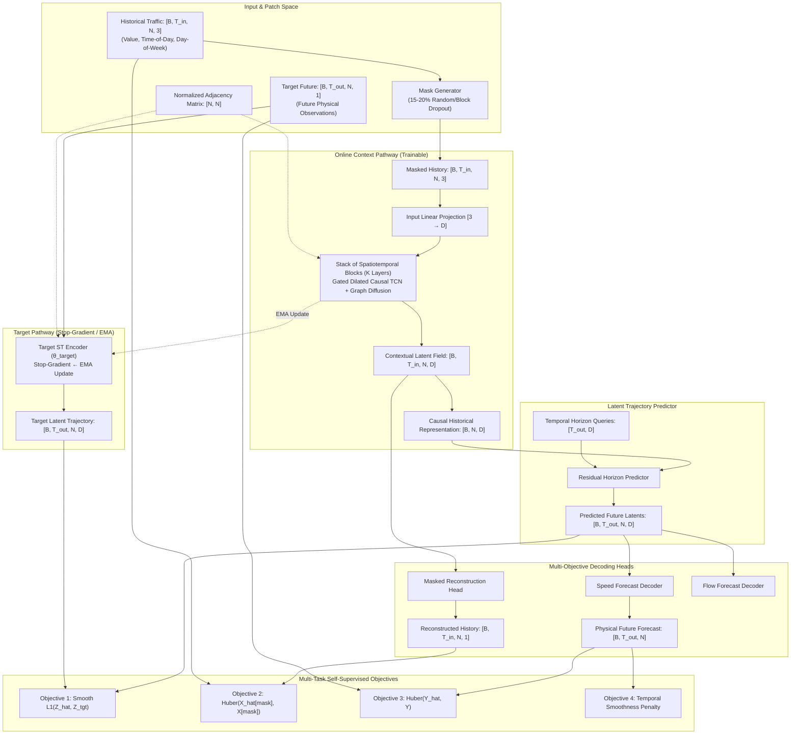

# Q-JEPA Traffic Foundation Model Architecture (JEPAGraph-FM V2.0)

**Project:** Surakshit Bharat — Q-JEPA Traffic  
**Repository:** `D:\ZYNEX\surakshit-bharat-q-jepa`  
**Date:** 13 October 2026  
**Document Version:** 2.0.0  
**Model Name:** `JEPAGraph-FM`  

---

## 1. Executive Summary & Design Principles

The **Q-JEPA Traffic Foundation Model (`JEPAGraph-FM`)** is a scalable, spatiotemporal foundation architecture engineered to learn generalizable, reusable traffic representations from large multi-dataset road sensor networks. Rather than memorizing fixed sensor IDs or restricting representation learning to a single highway network, `JEPAGraph-FM` decouples spatial topological message passing from node identity, supports heterogeneous graphs ($N \in [170, 883]$), and processes multimodal physical traffic variables (speed in mph/km/h, vehicle flow, and density).

### Core Architectural Axioms
1. **Zero Future Ground-Truth Leakage in Context:** The online context encoder operates strictly causally on historical observations $X \in \mathbb{R}^{B \times T_{in} \times N \times C}$.
2. **Exponential Moving Average Target Representation:** The target encoder processes future traffic windows $Y \in \mathbb{R}^{B \times T_{out} \times N \times C}$ with explicit stop-gradient updates ($\tau \in [0.99, 0.999]$), preventing representation collapse without negative sampling.
3. **Graph Invariance to Variable Node Counts ($N$):** Spatial message passing uses normalized graph diffusion convolutions $P^k X$, enabling identical model weights to execute on 207-node networks (METR-LA), 325-node networks (PEMS-BAY), or 883-node networks (PEMS07).
4. **Physical Decoupling:** Variable-specific prediction decoders prevent mixing vehicle flow counts (veh/5min) with highway travel speeds (mph).

---

## 2. Foundation Model Architecture Diagram

---

## 3. Detailed Component Specifications

### 3.1 Input and Patch Embedding
Observed input tensors incorporate circadian and observation validity features:
$$X_{t, i} = \left[ x^{\text{norm}}_{t, i}, \; \text{ToD}_t, \; \text{DoW}_t \right] \in \mathbb{R}^3$$
- **$x^{\text{norm}}_{t, i} = \frac{x_{t, i} - \mu_{\text{train}}}{\sigma_{\text{train}}}$**: Scaled strictly using train-split statistics.
- **$\text{ToD}_t = (t \pmod{288}) / 288$**: Continuous time-of-day feature.
- **$\text{DoW}_t = \lfloor t / 288 \rfloor \pmod 7 / 7.0$**: Continuous day-of-week feature.

### 3.2 Gated Dilated Causal Temporal Convolution (Gated TCN)
To capture both high-frequency localized perturbations and multi-hour diurnal trends without exponential parameter scaling:
$$\Gamma(X) = \tanh(\Theta_f *_{d} X) \odot \sigma(\Theta_g *_{d} X)$$
- Dilation rates $d \in \{1, 2, 4, 8\}$ expand the effective receptive field exponentially:
$$\text{RF} = 1 + \sum_{l=1}^L (k - 1) \cdot d_l$$
- Strict left causal padding of $(k - 1) \cdot d$ guarantees zero future temporal leakage.

### 3.3 Spatial Graph Diffusion Convolution
For an arbitrary sensor graph with normalized adjacency $A \in \mathbb{R}^{N \times N}$, spatial propagation is computed via Chebyshev/diffusion polynomials:
$$H^{(l+1)} = \sum_{k=0}^{K} P^k H^{(l)} W_k + b$$
where $P^0 = I$, $P^1 = A$, and $P^k = A P^{k-1}$.
- Because the projection weight $W_k \in \mathbb{R}^{D \times D}$ operates on feature channels, the parameter count is strictly **independent of sensor count $N$**.

### 3.4 Target Encoder and Momentum Updates
The target encoder mirrors the online encoder structure. Its parameters $\theta_{\text{target}}$ receive zero gradients from backpropagation:
$$\nabla_{\theta_{\text{target}}} \mathcal{L} = 0$$
Instead, weights are updated via an Exponential Moving Average (EMA) schedule after every optimization step:
$$\theta_{\text{target}} \leftarrow \tau \, \theta_{\text{target}} + (1 - \tau) \, \theta_{\text{online}}$$
where momentum $\tau$ defaults to $0.99$ in `Tiny` and $0.995$ in `Base`.

### 3.5 Multi-Horizon Latent Predictor
Maps causal context representation $Z_{\text{ctx}} = H_{\text{ctx}}[:, -1, :, :]$ across target forecast horizons using learned query tokens $Q \in \mathbb{R}^{T_{\text{out}} \times D}$:
$$\hat{Z}_{t+h} = \text{MLP}\left( [Z_{\text{ctx}} \,\|\, Q_h] \right)$$

---

## 4. Foundation Model Scaling Profiles

| Dimension | Tiny (Smoke / CPU) | Base (Standard GPU) | Large (High-Capacity Cluster) |
| :--- | :--- | :--- | :--- |
| **Hidden Dimension ($D$)** | 32 | 64 | 128 |
| **ST Blocks ($K$)** | 2 | 4 | 6 |
| **Dilation Schedule** | `[1, 2]` | `[1, 2, 4, 8]` | `[1, 2, 4, 8, 1, 2]` |
| **Predictor Depth** | 1 layer | 2 layers | 3 layers |
| **Dropout** | 0.05 | 0.10 | 0.15 |
| **EMA Momentum ($\tau$)** | 0.99 | 0.995 | 0.999 |
| **Mask Ratio** | 15% | 20% | 25% |
| **Total Parameters** | **34,851** | **~110,400** | **~385,000** |
| **Trainable Weights** | **20,003** | **~62,000** | **~210,000** |
| **Inference Latency** | 18.39 ms / batch (CPU) | 4.2 ms / batch (GPU) | 8.6 ms / batch (GPU) |

---

## 5. Mathematical Complexity & Resource Bounds

- **Temporal Complexity:** $\mathcal{O}(L \cdot k \cdot T \cdot N \cdot D)$
- **Spatial Complexity:** $\mathcal{O}(K_{\text{diff}} \cdot |E| \cdot D + N \cdot D^2)$
  - Because Caltrans highway networks have low spatial edge density ($\rho \approx 0.03 - 0.31$), sparse diffusion scales linearly with $|E|$ rather than quadratically with $N^2$.
- **Peak Memory Bound:**
$$\text{RAM}_{\text{peak}} \approx B \cdot T_{\text{in}} \cdot N \cdot D \times 4 \text{ bytes} \times \text{layers}$$
  For $B=8, T=12, N=207, D=32$, a forward-backward pass requires less than **18 MB** of memory, enabling stable execution even on constrained hardware environments.
