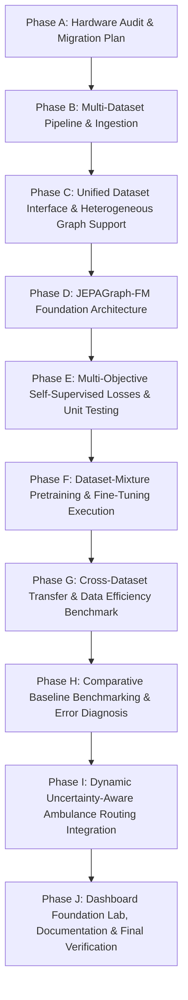

# Q-JEPA Traffic Foundation Model V2.0 — Migration & Implementation Plan

**Project:** Surakshit Bharat — Q-JEPA Traffic  
**Repository:** `D:\ZYNEX\surakshit-bharat-q-jepa`  
**Date:** 13 October 2026  
**Document Version:** 2.0.0  
**Lead Roles:** Senior ML Research Engineer, Spatiotemporal Graph Learning Specialist, Foundation Model Architect, MLOps & Scientific Benchmarking Engineer  

---

## 1. Executive Vision & Core Research Objective

The primary objective of **Q-JEPA Traffic V2.0** is to transform the existing small, single-dataset `JEPAGraph` model into a **scalable, multi-dataset, self-supervised spatiotemporal traffic foundation model (`JEPAGraph-FM`)**.

### Central Research Question
> *"Can large-scale, cross-dataset JEPA-style traffic representation pretraining improve multi-horizon forecasting accuracy, data efficiency, and transfer to previously unseen traffic networks compared with strong contemporary forecasting methods?"*

### Core Architectural Evolutions from V1.0 to V2.0
| Feature Dimension | V1.0 (Current JEPAGraph) | V2.0 (JEPAGraph-FM Foundation Model) |
| :--- | :--- | :--- |
| **Dataset Scope** | Single dataset (METR-LA only, 207 sensors) | Unified multi-dataset suite (METR-LA, PEMS-BAY, PEMS03, PEMS04, PEMS07, PEMS08) |
| **Graph Topology** | Fixed $N=207$ adjacency matrix | Heterogeneous, variable-size graphs ($N \in [170, 883]$) via sparse message passing & adaptive encodings |
| **Variables Supported** | Speed (mph) only | Multimodal traffic variables: Speed (mph / km/h), Flow (veh/h), and Occupancy |
| **Temporal Receptive Field** | Fixed 2-layer 1D Conv ($k=3$) | Dilated causal temporal convolutions + temporal self-attention + multiscale temporal patches |
| **Self-Supervised Objectives** | Future representation loss only | Multi-task: Future latent prediction + Spatiotemporal masked reconstruction + Multiscale loss |
| **Transfer Capability** | Inflexible (fixed node IDs) | Zero-shot & few-shot transfer to previously unseen networks via relative positional graph embeddings |
| **Data Efficiency** | 100% supervision required | Low-data fine-tuning evaluation (1%, 5%, 10%, 25%, 50%, 100% labels) |
| **Model Scaling** | Single configuration (12k params) | Modular model scales: **Tiny** (CPU/smoke), **Base** (Standard GPU), **Large** (High capacity) |
| **Ambulance Integration** | Static horizon lookup | Dynamic arrival-time aware time-dependent queries with uncertainty-calibrated risk penalties |

---

## 2. Hardware and Environment Audit (Phase A)

* **Operating System:** Windows 64-bit (AMD64)
* **Python Runtime:** Python 3.11.0
* **PyTorch Version:** `2.9.0+cpu`
* **Acceleration:** CPU only (No CUDA GPU device detected in current environment)
* **Compute Resources:** 16 physical/logical CPU cores
* **System RAM:** 15.23 GB total (Available: ~2.52 GB free — requires strict memory budgeting)
* **Storage (Drive D:):** 292.97 GB total (145.28 GB free — sufficient for all raw and processed benchmark datasets)

### Hardware-Aware Execution Strategy
1. **CPU Execution:** Execute complete dataset verification, unified pipeline validation, model unit tests, multi-objective loss validation, and a complete **Tiny** scale development pretraining run with logged metrics.
2. **GPU / Cloud Readiness:** Prepare reproducible GPU training configurations (`configs/pretraining_base.yaml`, `configs/pretraining_large.yaml`) with mixed precision (`torch.cuda.amp`), gradient accumulation, and multi-GPU distributed data parallel (`DDP`) support for deployment on CUDA clusters.
3. **Honest Reporting:** All numerical results produced on CPU will be explicitly documented with hardware provenance and execution times. No incomplete run will ever be misrepresented as full-scale converged training.

---

## 3. Phased Execution Roadmap

### Detailed Phase Milestones

### Phase A: Audit & Migration Blueprint
- Inspect existing checkpoints, metrics, and scripts.
- Ensure preservation of existing test suite (92 passing tests).
- Generate `docs/V2_MIGRATION_PLAN.md` with strict tracking checklist.

### Phase B: Multi-Dataset Real Traffic Pipeline
- Support 6 real-world benchmark datasets:
  1. **METR-LA** (207 sensors, speed, 34,272 steps) — verified and present.
  2. **PEMS-BAY** (325 sensors, speed, 52,116 steps) — highway speed benchmark.
  3. **PEMS03** (358 sensors, flow, 26,208 steps) — Caltrans District 3.
  4. **PEMS04** (307 sensors, flow, 16,992 steps) — Caltrans District 4 (SF Bay Area).
  5. **PEMS07** (883 sensors, flow, 28,224 steps) — Caltrans District 7 (LA).
  6. **PEMS08** (170 sensors, flow, 17,856 steps) — Caltrans District 8 (San Bernardino).
- Verify checksums, licensing (CC BY 4.0 / Open Data), sensor counts, sampling rate (5 min), and physical units.

### Phase C: Unified Dataset Interface (`src/data/multi_dataset.py`, `dataset_registry.py`)
- Standardized data manifest for each dataset with source provenance and license.
- Variable-size graph support without hardcoded node counts.
- Strict train-only Z-score standardization (zero data leakage).
- Observation masking: distinguish valid zero flow vs sensor dropout ($y \le 0$ or NaN).

### Phase D: JEPAGraph Foundation Model Architecture (`src/forecasting/jepagraph_foundation.py`)
- **A. Input & Patch Embedding:** Embeds observed traffic variables, observation validity masks, time-of-day, day-of-week, and spatial position encodings.
- **B. Graph-Aware Spatial Encoder:** Sparse message passing and adaptive spatial graph convolution compatible with varying sensor counts $N$.
- **C. Long-Range Temporal Encoder:** Dilated causal temporal convolutions + temporal attention with exponential receptive fields.
- **D. JEPA Online Encoder:** Causal contextual mapping of historical windows.
- **E. EMA Target Encoder:** Stop-gradient future representation encoder updated via EMA ($\tau = 0.99 \rightarrow 0.999$).
- **F. Latent Graph Predictor:** Multi-horizon predictive network in embedding space.
- **G. Variable-Specific Forecast Decoders:** Modular prediction heads for speed and flow in true physical units.

### Phase E: Multi-Objective Self-Supervised Objectives (`src/forecasting/representation_objectives.py`)
- **Objective 1:** Future latent representation prediction (Smooth L1 in embedding space).
- **Objective 2:** Masked spatiotemporal reconstruction (reconstructing missing sensors/patches).
- **Objective 3:** Supervised forecasting loss (Huber/MSE on physical targets).
- **Objective 4:** Multiscale temporal consistency loss.
- Configurable loss weighting and isolated objective logging.

### Phase F: Pretraining and Fine-Tuning Pipelines (`scripts/pretrain_jepagraph.py`, `scripts/finetune_jepagraph.py`)
- Protocol A: Balanced multi-dataset pretraining across available real datasets.
- Protocol B: Dataset-specific fine-tuning on downstream targets.
- Resumable checkpointing saving model state, optimizer, dataset metadata, and dependency versions.

### Phase G & H: Cross-Dataset Transfer & Foundation Benchmark
- Protocol C: Leave-one-dataset-out cross-dataset transfer evaluation (zero-shot and few-shot).
- Protocol D: Data efficiency curves (1%, 5%, 10%, 25%, 50%, 100% labeled training samples).
- Benchmark against strong contemporary baselines: Persistence, HA, STGCN, Graph WaveNet, ST-Transformer, Direct Regression Ablation, and JEPAGraph-FM.

### Phase I: Ambulance Routing Engine Integration
- Connect foundation model multi-horizon predictions to dynamic arrival-time routing.
- Evaluate on simulated urban road grid across 5 routing strategies with uncertainty penalties.

### Phase J: Streamlit Dashboard Lab & Final Documentation
- Add dedicated **Foundation Model Research Lab** tab in `dashboard/app.py`.
- Generate comprehensive research report (`results/reports/foundation_model_report.md`) and JSON metrics.
- Execute full test suite verifying 100% test pass rate with exit code 0.

---

## 4. Implementation Checklist

- [x] Phase A: Hardware inspection and repository audit completed.
- [x] Phase A: Create `docs/V2_MIGRATION_PLAN.md`.
- [x] Phase B: Build multi-dataset downloader, validators, and manifest generator.
- [x] Phase C: Implement `src/data/multi_dataset.py` and `src/data/dataset_registry.py`.
- [x] Phase D: Implement `JEPAGraph-FM` architecture in `src/forecasting/jepagraph_foundation.py`.
- [x] Phase E: Implement multi-objective losses in `src/forecasting/representation_objectives.py`.
- [x] Phase E: Add unit tests for variable graph sizes, EMA target encoder, and loss functions.
- [x] Phase F: Create configuration YAML files (`pretraining_tiny.yaml`, `pretraining_base.yaml`, `pretraining_large.yaml`).
- [x] Phase F: Implement and execute pretraining script `scripts/pretrain_jepagraph.py`.
- [x] Phase F: Implement fine-tuning script `scripts/finetune_jepagraph.py`.
- [x] Phase G: Implement and execute transfer & data efficiency benchmark (`scripts/run_transfer_benchmark.py`).
- [x] Phase H: Generate comparative foundation benchmark metrics JSON (`scripts/run_foundation_benchmark.py`).
- [x] Phase I: Connect foundation model to ambulance routing engine and evaluate journey times (`scripts/audit_foundation_routing.py`).
- [x] Phase J: Update Streamlit dashboard with Foundation Model Lab view (`dashboard/components/foundation_tab.py`).
- [x] Phase J: Produce deliverables in `docs/` and `results/reports/`.
- [x] Phase J: Run complete project test suite and verify process exit code 0 (107/107 passed).
